<p align="center"></p>

# rehalo — brand

**rehalo** is an open-source revival of the SmartHalo 2 bike light. The device is still called a SmartHalo 2. Use "rehalo" for the software only.

## The mark

**Spark:** the halo went dark, and one LED relights in the gap. The wordmark is set lowercase in
Unbounded ExtraBold with **re** in lime, because "re" is the revival.

| Token | Hex | Use |
| --- | --- | --- |
| Night | `#0B0D10` | Ground, one-colour mark on light/lime |
| Paper | `#F2F4F7` | Ring, "halo", one-colour mark on dark |
| Lime | `#C6FF3D` | Spark, "re". Never on light grounds (too pale) |

Type: **Unbounded 800**, tracking −3%, always lowercase (`rehalo`, never `Rehalo`/`ReHalo`).
The app's UI accent is the same lime (`Theme.accent`).

## Files

`svg/` (wordmark outlined, no font needed) and `png/` (512 px tall, transparent):

| File | What |
| --- | --- |
| `rehalo-horizontal*` | Symbol + wordmark, the primary lockup |
| `rehalo-stacked*` | Symbol above wordmark |
| `rehalo-wordmark*` | Wordmark only |
| `rehalo-symbol*` | Symbol only (avatars, favicons) |
| `rehalo-app-icon` | 1024² app icon on Night (opaque PNG) |

Suffix: none = colour, for **dark** grounds · `-night` = one colour, for light or lime grounds ·
`-paper` = one colour, for dark grounds or photos.

The iOS app icon (`clients/ios/Sources/SmartHalo2App/Assets.xcassets/AppIcon.appiconset`) has
any / dark / tinted appearances. The desktop icon is `clients/desktop/build/icon.png`.

## Regenerating

Everything above comes from `tools/build_mark.py` (geometry, colours and spacing live there):

```bash
pip install fonttools uharfbuzz          # plus rsvg-convert + ImageMagick on PATH
curl -LO "https://github.com/google/fonts/raw/main/ofl/unbounded/Unbounded%5Bwght%5D.ttf"
python3 brand/tools/build_mark.py "Unbounded[wght].ttf"
```

Unbounded is © The Unbounded Project Authors, SIL Open Font License 1.1. The SVGs contain its glyph
outlines, not the font file.
